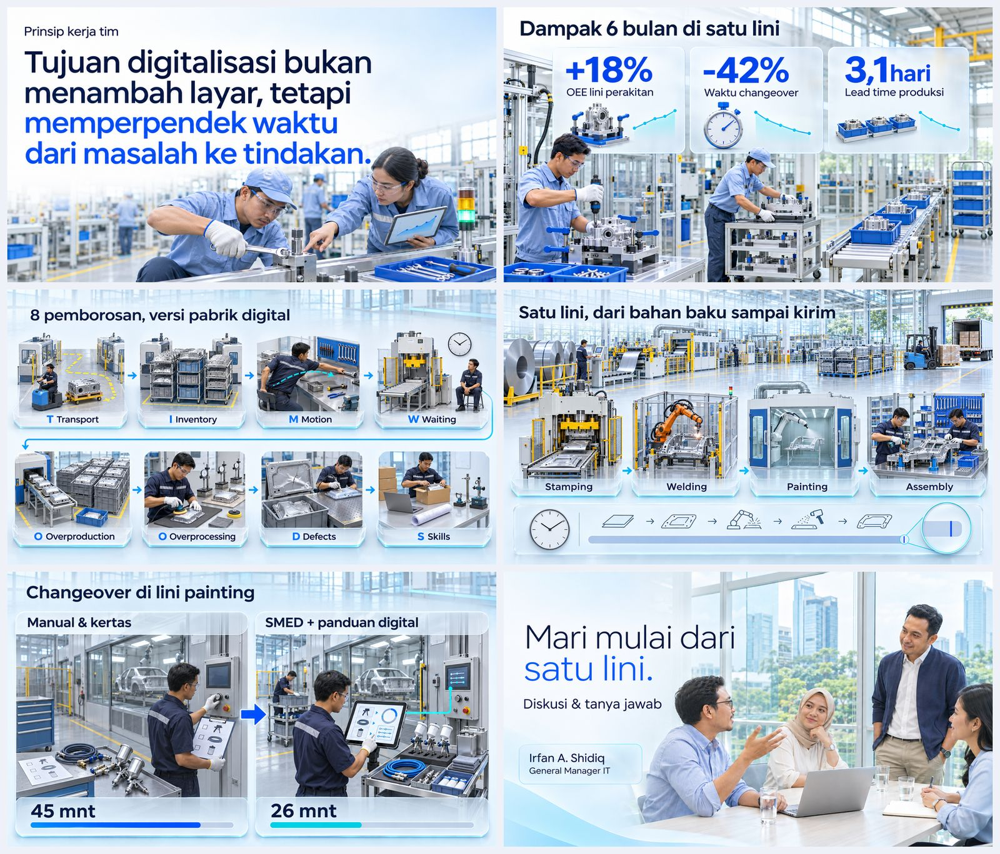
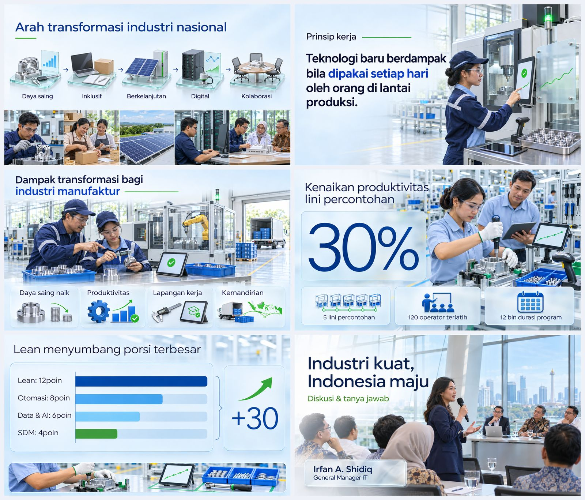
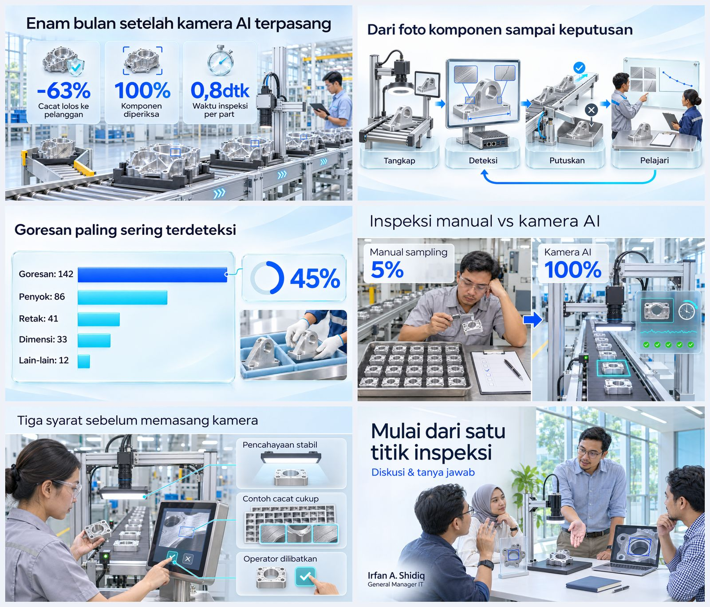

# IAS Deck Skill

**Skill presentasi untuk Claude Code & Codex yang menghasilkan deck bergaya poster sinematik — cerah, penuh visual, dan detail sesuai materi.**

Cukup minta dalam bahasa biasa:

> *"Buatkan deck 12 slide untuk Forum Kemenperin tentang transformasi digital di grup otomotif. Durasi 20 menit."*

AI akan menyusun alur cerita, menawarkan 3 pilihan gaya desain, lalu — setelah Anda memilih — merender setiap slide utuh dengan **GPT Image** (lewat Codex, memakai akun ChatGPT Anda). Hasil akhirnya **PDF** dan **PPTX** yang siap dipresentasikan.

---

## Contoh hasil desain

### Lean Digital Factory



### Transformasi Industri 4.0



### AI Quality Inspection



---

## Cara kerjanya (alur standar)

| Langkah | Yang terjadi | Yang Anda lakukan |
|---|---|---|
| **1. Brief** | AI menanyakan maksimal 3 hal: topik & acara, durasi, nuansa. | Jawab singkat, atau langsung beri detail di permintaan. |
| **2. Outline** | AI menampilkan tabel alur slide: nomor, jenis slide, judul, angka penting. Belum ada gambar yang dibuat. | Setujui atau minta ubah. |
| **3. Opsi gaya** | Sampul + 1 slide isi dirender dalam **3 gaya** sekaligus (±3 menit). | Pilih: *"Pakai Gaya B"*. |
| **4. Generate penuh** | Semua slide dirender dengan gaya pilihan — 4 proses berjalan paralel (±1–2 menit per 3 slide). | Tunggu. |
| **5. Pemeriksaan** | AI memeriksa setiap slide: ejaan, angka, kecocokan visual dengan materi, tanda "AI slop". Slide yang bermasalah diperbaiki. | Minta perubahan bila perlu: *"slide 4 angkanya jadi 50%"*. |
| **6. Hasil** | `nama-poster.pdf`, `nama-poster.pptx` (dengan catatan pembicara), dan `nama-poster.html` (presentasi di browser). | Presentasikan. |

### Pilihan gaya

| Gaya | Karakter | Cocok untuk |
|---|---|---|
| **A · Glass Tech** (`glass`) | Cerah putih-biru, foto realistis, panel kaca hologram berisi angka, ikon 3D | Keynote teknologi, digitalisasi, AI |
| **B · Editorial Nasional** (`editorial`) | Poster institusi navy & hijau, kolase foto bersudut/heksagon, pita sorotan, deret ikon bulat | Forum kementerian, acara resmi, kebijakan |
| **C · Isometric 3D** (`isometric`) | Dunia ilustrasi 3D isometrik yang bersih dan ramah | Penjelasan proses, edukasi, konsep sistem |
| **D · Cinematic Sunrise** (`cinematic`) | Fotografi sinematik cahaya pagi, hangat dan megah | Visi, pembukaan acara, penutupan |

### Materi apa saja
Latar visual mengikuti topik — **bukan selalu pabrik**: kantor & ruang rapat (strategi, SDM, budaya kerja), data center & ruang kendali (IT, AI, keamanan siber), kota pintar & layanan (digitalisasi), tambang/perkebunan/konstruksi/logistik (operasi lapangan), gedung pemerintahan (kebijakan), kampus (pelatihan), dan pabrik bila memang membahas manufaktur.

### Prinsip desain yang dijaga otomatis
- **Satu slide, satu pesan.** Judul berupa kesimpulan, bukan topik.
- **Teks singkat, visual detail.** Judul ≤ 8 kata, label ≤ 4 kata; isi materi lengkap dipakai sebagai petunjuk gambar sehingga setiap poin divisualkan secara spesifik.
- **Komposisi bervariasi.** Foto utama, kartu data dalam adegan, diagram 3D, tipografi besar, perbandingan split — dua slide berurutan tidak pernah sama.
- **Grafik sesuai makna data.** Tren → garis, perbandingan → batang, peringkat → batang horizontal, porsi → donut. Grafik *waterfall* maksimal satu per deck.
- **Anti "AI slop".** Satu fokus visual per slide, cahaya dan proporsi realistis, tanpa glow berlebihan, ikon melayang acak, dashboard palsu, wajah plastik, atau gradien ungu.
- **Tipografi elegan.** Judul semi-bold, label regular — tidak tebal berlebihan.
- **Angka tidak dikarang.** Bila data belum ada, slide diberi label "(data ilustrasi)".

---

## 1. Pemasangan (sekali, ±3 menit)

**Kebutuhan:** Mac · [Google Chrome](https://google.com/chrome) · [Node.js 18+](https://nodejs.org) (`brew install node`) · Python 3 · [Codex CLI](https://github.com/openai/codex) yang sudah login akun ChatGPT.

```bash
git clone --recurse-submodules https://github.com/ffaizdaffa/ias-deck-skill.git
cd ias-deck-skill
./install.sh
```

Login Codex (sekali saja, pilih *Sign in with ChatGPT*):

```bash
codex login
```

Installer akan:
1. memeriksa Node, Chrome, Python, dan memasang `python-pptx`;
2. memasang skill `ias-deck` ke `~/.claude/skills/` **dan** `~/.codex/skills/`;
3. memasang 3 skill pendukung (bagian 6);
4. memasang font tema;
5. menyiapkan halaman pemilih tema (`out/picker.html`) dan memeriksa Codex.

**Memperbarui:** `git pull --recurse-submodules && ./install.sh`

---

## 2. Cara memakai

Buka sesi **baru** Claude Code atau Codex di folder kerja mana pun, lalu tulis permintaan. Contoh:

> *Buatkan deck 10 slide, keynote 20 menit di seminar Kemenperin. Topik: AI untuk predictive maintenance di pabrik komponen otomotif. Pembicara Irfan A. Shidiq, GM IT. Data: downtime turun 45%, biaya suku cadang turun 20%.*

> *Buat deck 8 slide tentang strategi digitalisasi layanan keuangan untuk rapat direksi, nuansa formal.*

Selama proses, cukup jawab dengan bahasa biasa:
- *"Outline-nya oke, lanjut."*
- *"Pakai Gaya B."*
- *"Slide 5 angkanya ganti jadi 52%."* → AI memperbaiki slide itu saja.
- *"Slide 3 gambarnya kurang cocok, ulang."* → AI merender ulang slide itu.

### Hasil yang Anda terima
| File | Isi |
|---|---|
| `out/<nama>-poster.pdf` | Deck siap kirim / cetak |
| `out/<nama>-poster.pptx` | Satu gambar per slide + catatan pembicara (untuk presenter view PowerPoint/Keynote) |
| `out/<nama>-poster.html` | Presentasi di browser: `→`/`←` pindah slide, `F` layar penuh |

---

## 3. Mengubah isi slide

Setiap slide adalah satu desain utuh dari GPT Image. Untuk mengubah isi, jangan mengedit di PowerPoint — minta saja ke AI:

| Kebutuhan | Contoh permintaan | Yang terjadi |
|---|---|---|
| Ganti angka / kata | *"Slide 4, ganti 45% jadi 50%"* | Hanya slide 4 yang diedit; desain lain tetap sama (±1 menit) |
| Ganti visual | *"Slide 3 gambarnya kurang cocok, tampilkan ruang rapat"* | Slide 3 dirender ulang dengan arahan baru |
| Tambah / hapus slide | *"Tambah slide roadmap setelah slide 6"* | Outline diperbarui, slide baru dirender dengan gaya yang sama |
| Ganti gaya seluruh deck | *"Coba gaya Editorial Nasional"* | Seluruh slide dirender ulang dengan gaya baru |

Versi sebelumnya tetap tersimpan, jadi perubahan selalu bisa dibatalkan.

## 4. Perintah manual (tanpa AI)

Semua perintah dijalankan dari folder repo.

```bash
E=skills/ias-deck/engine
node $E/render.mjs deck.json --options --out out                 # 3 opsi gaya (sampul + 1 slide isi)
node $E/render.mjs deck.json --poster --out out                  # deck penuh mode poster → PDF + PPTX + HTML
node $E/render.mjs deck.json --fix 4 "ganti 45% menjadi 50%"     # perbaiki satu slide, sisanya tetap
node $E/render.mjs deck.json --poster --slides 4 --force         # render ulang satu slide dari nol
node $E/render.mjs deck.json --all                               # cadangan tanpa Codex (template, bisa diedit)
node $E/render.mjs --list                                        # daftar tema & jenis slide
```

Gaya poster dipilih lewat field `"posterStyle"` di file deck (`glass`, `editorial`, `isometric`, `cinematic`); latar visual lewat `"topic"`.
Contoh file deck ada di `skills/ias-deck/examples/`. Format lengkap: [`skills/ias-deck/references/layouts.md`](skills/ias-deck/references/layouts.md).

---

## 5. Isi repo

```
skills/ias-deck/
  SKILL.md                  instruksi kerja untuk Claude/Codex (alur, aturan desain, cara memeriksa)
  references/               panduan jenis slide, tema, cerita, ikon, pustaka gambar
  examples/                 contoh deck (lean, transformasi industri, AI predictive maintenance, AI quality inspection)
  assets/heroes/            100 gambar pendukung + galeri (index.html)
  engine/
    render.mjs              perintah utama: poster, opsi gaya, perbaikan slide
    poster.mjs              mode poster: gaya, arahan visual per slide, aturan anti AI slop, perbaikan slide
    layouts.mjs, deck.css, deck.js, export_pptx.py   versi cadangan berbasis template (tanpa Codex)
    themes.json             41 tema warna & tipografi
docs/showcase/              gambar contoh di README
install.sh                  pemasang satu perintah
vendor/                     3 skill pendukung berlisensi MIT
```

---

## 6. Skill pendukung (lisensi MIT)

Terpasang otomatis sebagai alternatif: `html-ppt` (deck HTML beranimasi), `frontend-slides` (deck HTML gaya bebas), `ppt-master` (PPTX native dari dokumen). Masing-masing tetap memakai lisensi aslinya di folder `vendor/`.

---

## 7. Pertanyaan umum

**Berapa lama membuat satu deck?** Outline ±1 menit, opsi gaya ±3 menit, deck 10 slide ±4–6 menit.

**Apakah ada biaya tambahan?** Gambar dibuat lewat Codex memakai kuota akun ChatGPT Anda; tidak ada layanan lain yang ditagih.

**Teks di slide salah ketik / angka keliru?** Minta perbaikan: *"slide 6, ganti 'Goresan' jadi 'Gores'"* — hanya slide itu yang diedit.

**Bisa diedit di PowerPoint?** Setiap slide berupa gambar desain utuh. Perubahan isi dilakukan lewat permintaan ke AI (lihat bagian 3) — lebih cepat dan desain tetap rapi.

**Bisa pakai logo perusahaan?** Ya. Visual AI sengaja tanpa logo; logo resmi ditempel di PPTX akhir (misalnya di pojok setiap slide).

**Codex belum login?** Jalankan `codex login` (pilih *Sign in with ChatGPT*). Tanpa Codex, AI hanya bisa membuat versi template sederhana sebagai cadangan.

**Skill tidak muncul?** Pastikan membuka sesi Claude Code/Codex **baru** setelah `./install.sh`.
